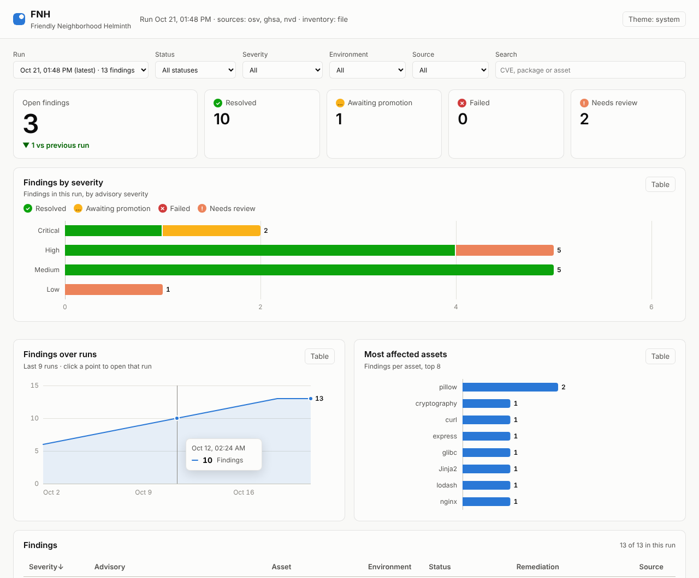

# FNH (Friendly Neighborhood Helminth)

[](https://github.com/0xFulgrim/FNH/actions/workflows/ci.yml)
[](LICENSE)

FNH matches vulnerability advisories against the software you run, applies
patches or mitigations on a staging host, checks that the fix worked, and
queues validated production changes for approval.

It is meant for infrastructure you own and operate.

## Features

- Advisories from [OSV](https://osv.dev), the [GitHub Advisory Database](https://github.com/advisories),
  [NVD](https://nvd.nist.gov) or a local JSON file, alone or combined
- Inventory from a JSON file, or collected live from a host with `pip`, `dpkg` and `npm`
- Version-range matching with dpkg, PEP 440 and SemVer ordering
- Patch selection, with a fallback to a mitigation library
- Remediation runs locally or on a remote staging host over SSH
- Post-fix validation: version checks for patches, HTTP/TCP probes for mitigations
- Automatic rollback when a step or validation fails
- Production changes are written out as promotion requests and applied only with `--approve`
- Optional local web dashboard for run reports (`fnh dashboard`)
- No runtime dependencies outside the Python standard library

## Installation

Requires Python 3.10 or later.

```bash
git clone https://github.com/0xFulgrim/FNH.git
cd FNH
pip install -e .
```

This installs the `fnh` command. `python -m fnh` also works.

The remote runner uses the system `ssh` client. Mitigation probes use `curl`
and `bash` on the staging host.

## Quick start

Run against the bundled examples. `--dry-run` prints the commands without
executing anything:

```bash
fnh run --dry-run
```

```
## Summary
- mitigated: 1
- needs_review: 1
- patched: 1

## CVE-2026-0001 — requests [patched]
- severity: high
- why: requests 2.31.0 satisfies vulnerable range '<2.32.0'
- remediation: Upgrade requests to 2.32.0 (kind=patch, validated=True)
...
```

## Usage

### Scan and remediate

```bash
# OSV advisories for the packages in an inventory file
fnh run --source osv --inventory inventory.json --cache .osv-cache.json

# Collect packages from a staging host and remediate there
fnh run --source osv \
  --inventory-source live --collect pip,dpkg \
  --staging-host staging.internal --staging-user deploy \
  --ssh-identity ~/.ssh/fnh --ssh-known-hosts ./known_hosts

# Queue production fixes that pass on staging
fnh run --source osv --inventory inventory.json --promote-dir ./promotions

# Combine sources
GITHUB_TOKEN=... NVD_API_KEY=... fnh run --source osv,ghsa,nvd --inventory inventory.json
```

### Advisory sources

| Source | Matches on | Notes |
|--------|------------|-------|
| `file` | ecosystem + name | Local JSON, format below. The default. |
| `osv` | ecosystem + name | Aggregates GHSA, PyPA, RustSec, Debian, Ubuntu and more. Batch queries; `--cache` keeps records between runs. Best choice for distro packages. |
| `ghsa` | ecosystem + name | GitHub's reviewed advisories for pip, npm, Go, Maven, NuGet, RubyGems, Composer, Rust, Pub and Hex. Set `GITHUB_TOKEN` for 5,000 requests/hour instead of 60. |
| `nvd` | CPE | Only for assets with a `cpe`. Paced to NVD's limits: 5 requests per 30 s, or 50 with `NVD_API_KEY`. |

Sources run in the order `file, osv, ghsa, nvd`. When two report the same CVE
for the same asset, the first one's ranges and fixed versions are used. A feed
error stops the run with exit code 2 before anything is changed.

| Flag | Description |
|------|-------------|
| `--source LIST` | Comma-separated sources: `file`, `osv`, `ghsa`, `nvd` (default `file`) |
| `--advisories PATH` | Advisory file for `--source file` |
| `--cache PATH` | OSV record cache file |
| `--no-batch` | One OSV `/v1/query` per package instead of `/v1/querybatch` |
| `--inventory-source {file,live}` | Inventory source (default `file`) |
| `--inventory PATH` | Inventory file for `--inventory-source file` |
| `--collect LIST` | Live collectors: `pip`, `dpkg`, `npm` (default `pip`) |
| `--environment NAME` | Environment label for collected assets (default `staging`) |
| `--dpkg-ecosystem NAME` | OSV ecosystem for dpkg packages, e.g. `Debian:12` (default: detected from the host) |
| `--mitigations PATH` | Mitigation library |
| `--staging-host HOST` | Run steps on this host over SSH (local if omitted) |
| `--staging-user`, `--staging-port` | SSH user and port |
| `--ssh-identity PATH` | SSH private key |
| `--ssh-known-hosts PATH` | Pinned known_hosts file |
| `--ssh-trust-new` | Accept unknown host keys on first connect |
| `--promote-dir DIR` | Write promotion requests here |
| `--allow-production` | Change production assets directly on `--prod-host` |
| `--prod-host HOST` | Production host over SSH (required with `--allow-production`) |
| `--prod-user`, `--prod-port` | SSH user and port for the production host |
| `--report-dir DIR` | Also write a JSON report of the run here, for `fnh dashboard` |
| `--dry-run` | Print commands, execute nothing |

### Promote to production

```bash
# List requests
fnh promote --promote-dir ./promotions

# Show the steps for one request
fnh promote --promote-dir ./promotions --apply 3f1c9a2b7d10

# Apply it
fnh promote --promote-dir ./promotions --apply 3f1c9a2b7d10 --approve \
  --approved-by alice --prod-host prod.internal --prod-user deploy
```

Without `--approve`, `promote --apply` prints the steps and exits 1. With it,
it needs a target: `--prod-host`, or `--local` to apply on the machine running
`fnh`. The steps run there and the result is checked: the verify
probe for mitigations, the installed version for patches. The rollback runs if
either fails. The outcome is saved on the request, and an applied request
can't be applied again. Repeated `fnh run`s reuse a pending request instead of
queuing duplicates.

### Live inventory

`--inventory-source live` reads installed packages from the staging host (or
this machine) through the same runner used for remediation:

- `pip`: `pip list`, ecosystem `pypi`.
- `npm`: `npm ls --depth=0`, ecosystem `npm`.
- `dpkg`: one asset per *source* package, because Debian and Ubuntu advisories
  name source packages (`openssl`), not the binaries built from them
  (`libssl3`). Upgrades act on the installed binaries. The OSV ecosystem
  (`Debian:12`, `Ubuntu:24.04:LTS`) is read from `/etc/os-release`; if that
  fails the packages get the generic `os` ecosystem.

PyPI names match regardless of case and `-`/`_`/`.` (so `typing_extensions`
matches `typing-extensions`).

## Dashboard

An optional, read-only web view of your runs. Write a report from each run,
then point the dashboard at the directory:

```bash
fnh run --source osv --inventory inventory.json --report-dir ./reports
fnh dashboard --report-dir ./reports --promote-dir ./promotions --open
```



It shows open findings against the previous run, findings by severity and
status, the trend across runs, the most affected assets, a searchable findings
table with each finding's remediation, notes and references, and the promotion
queue. Filters at the top apply to everything on the page, every chart has a
table view, and new runs appear without a reload. Light and dark themes follow
the system or the toggle.

The dashboard never changes anything; promotions are still applied with
`fnh promote`. It uses only the Python standard library and serves its own
static files, with no third-party scripts or fonts.

| Flag | Description |
|------|-------------|
| `--report-dir DIR` | Reports written by `fnh run --report-dir` (required) |
| `--promote-dir DIR` | Also show queued promotion requests |
| `--host`, `--port` | Bind address (default `127.0.0.1:8765`) |
| `--open` | Open it in the default browser |

Reports describe your infrastructure, so the server binds to `127.0.0.1` and
has no authentication. It rejects requests addressed to any other host name,
which stops DNS-rebinding pages from reading it through your browser, and sends
a strict Content-Security-Policy. Advisory text from the feeds is always
displayed as text. Binding to another address prints a warning; put it behind
an authenticating proxy if you do.

## Input formats

### Inventory

```json
[
  {"id": "api-requests", "name": "requests", "ecosystem": "pypi",
   "version": "2.31.0", "environment": "staging"},
  {"id": "edge-proxy", "name": "nginx", "version": "1.18.0",
   "environment": "production", "cpe": "cpe:2.3:a:f5:nginx"}
]
```

`cpe` is only used by the NVD source. The `vendor:product` shorthand means an
application (`cpe:2.3:a:...`); write OS and hardware CPEs in full.
An entry with a `cpe` and no `ecosystem` gets ecosystem `cpe`: it can be
matched, but upgrading it is left to a human.

Supported `ecosystem` values for OSV lookups: `pypi`, `npm`, `go`, `maven`,
`nuget`, `cargo`, `rubygems`, `composer`, `pub`, `hex`, or any OSV ecosystem
name such as `Debian:12`.

### Advisories (`--source file`)

```json
[
  {"id": "CVE-2026-0001", "cvss": 8.1,
   "affected": [{"ecosystem": "pypi", "name": "requests"}],
   "vulnerable_ranges": ["<2.32.0"], "fixed_versions": ["2.32.0"]}
]
```

When an advisory covers several packages with different ranges, give each
`affected` entry its own `"ranges"` and `"fixed"` lists; they override the
advisory-wide ones for that package.

### Mitigation library

Entries are keyed by advisory ID or package name. `verify` is a probe spec
or a shell command. Exit status 0 means the issue is closed.

```json
{
  "CVE-2026-0002": {
    "description": "Reject malformed chunked bodies at the edge",
    "steps": ["cp hardening.conf /etc/nginx/conf.d/", "nginx -t", "nginx -s reload"],
    "rollback": ["rm /etc/nginx/conf.d/hardening.conf", "nginx -s reload"],
    "confidence": 0.8,
    "verify": {"probe": "http_status", "url": "https://staging.internal/",
               "method": "POST", "header": "Transfer-Encoding: chunked",
               "data": "malformed", "expect": 400}
  }
}
```

| Probe | Passes when | Fields |
|-------|-------------|--------|
| `http_status` | Response code equals `expect` | `url`, `expect`, `method`, `header`, `data`, `insecure`, `timeout` |
| `http_header_absent` | Response lacks `header` | `url`, `header`, `insecure`, `timeout` |
| `port_closed` | TCP connect fails | `host`, `port`, `timeout` |
| `command_fails` | `cmd` exits non-zero | `cmd` |

## How it works

1. Load advisories and inventory.
2. Match advisories to assets by ecosystem, name and version range.
3. Plan a remediation: the lowest fixed version above the installed one,
   otherwise a mitigation library entry, otherwise none.
4. Check the plan against the safety policy.
5. Apply on staging, validate, and roll back on failure.
6. For production assets, write a promotion request if a promoter is configured.
7. Print a Markdown report with next steps for anything left open.

Outcome states: `patched`, `mitigated`, `awaiting_promotion`, `needs_review`, `failed`.

## Safety defaults

Defined in `fnh/safety.py`:

- Steps run automatically only for `staging` assets.
- Production needs approval through `fnh promote`, unless `--allow-production` is
  set with a `--prod-host`. Production commands never run on the staging host.
- The plan checks below also apply to fixes validated on staging for promotion.
- Plans need confidence of at least 0.75 and severity of at least `high`.
- Steps containing `rm -rf /`, `mkfs`, `dd if=`, `> /dev/sd` or a fork bomb are refused.
- Without a probe, a mitigation on a live host is not counted as validated.
- SSH runs with `BatchMode=yes` and `StrictHostKeyChecking=yes` by default.

## Limitations

- Versions are compared with dpkg ordering for Debian and Ubuntu, PEP 440 for
  PyPI and SemVer 2.0 for npm. Other ecosystems, and versions that don't parse,
  fall back to the leading dotted numeric part, so their pre-releases compare
  equal to the release.
- Automated patching covers pip, npm and apt. Other ecosystems get a plan that
  needs a human.
- CVSS v4 vectors in OSV records are not scored; FNH uses the record's severity
  label. GHSA and NVD supply numeric scores.
- NVD ranges are upstream versions. Distro packages that backport fixes without
  changing the upstream version show up as false positives; use OSV for them.
- NVD configurations that need two products together (an app on a specific OS)
  are matched on the vulnerable product alone.
- Inventory entries with a generic `os` ecosystem are skipped for OSV lookups.
  Use a specific ecosystem like `Debian:12`.
- Live sources need outbound HTTPS to `api.osv.dev`, `api.github.com` or
  `services.nvd.nist.gov`.

## Development

```bash
pip install -e ".[dev]"
python -m pyflakes fnh tests
python -m pytest
```

Tests use injected transports and runners, so they run without network access or SSH.

| Module | Purpose |
|--------|---------|
| `feed.py`, `osv.py`, `ghsa.py`, `nvd.py` | Advisory sources |
| `httpclient.py` | Shared HTTPS client |
| `inventory.py` | File and live inventory |
| `matcher.py` | Version-range matching |
| `planner.py` | Patch or mitigation selection |
| `executor.py` | Runners and validators |
| `probes.py` | Verify command builders |
| `promote.py` | Promotion requests |
| `safety.py` | Safety policy |
| `cvss.py` | CVSS v3 scoring |
| `recommend.py` | Text report |
| `report.py` | JSON run reports |
| `dashboard.py`, `static/` | Dashboard server and page |
| `pipeline.py` | Orchestration |

## License

MIT. See [LICENSE](LICENSE).
